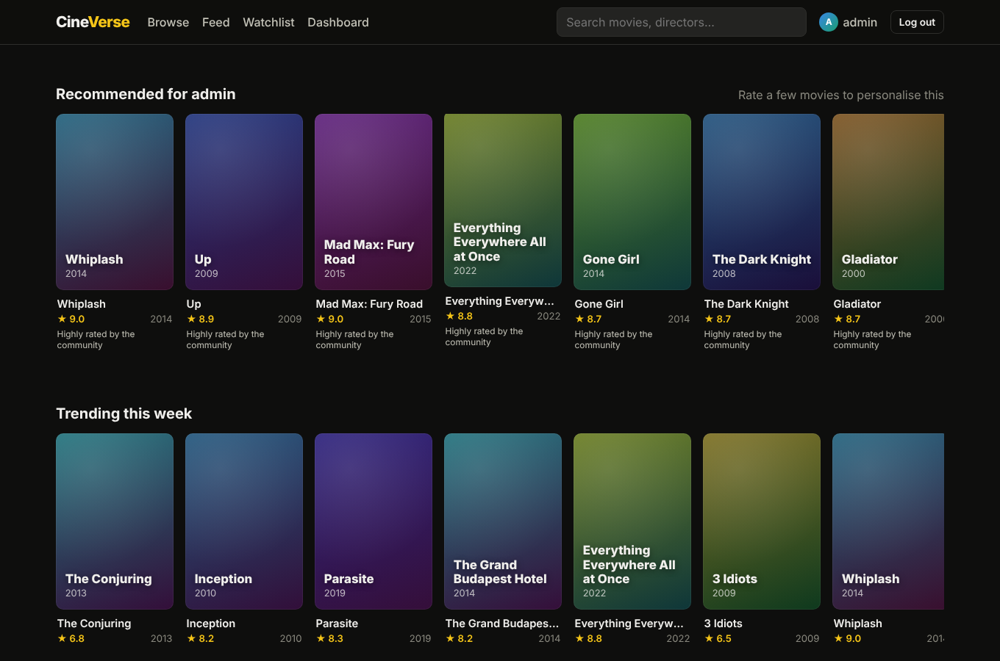
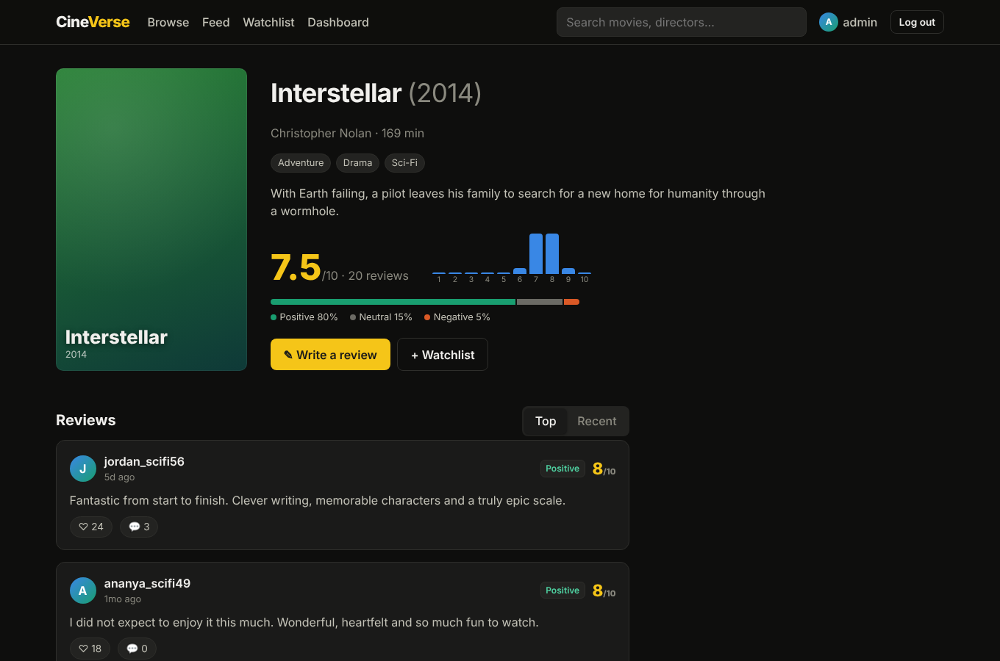
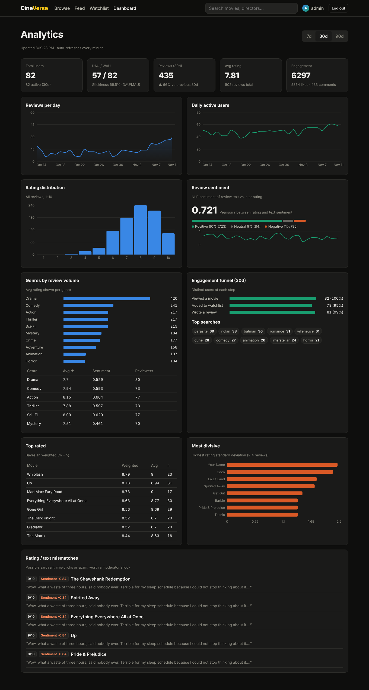
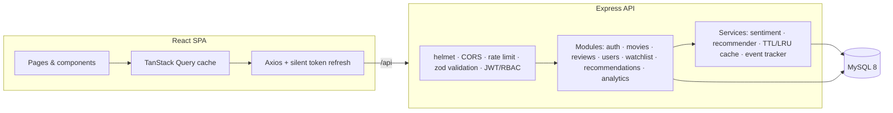

# 🎬 CineVerse: Movie Review & Discovery Platform

A full-stack movie review platform with a social layer, a **hybrid recommendation engine**, **NLP sentiment analysis** on every review, and a **product-analytics dashboard** built from a first-party event stream.

**Stack:** React 18 · Vite · TanStack Query · Recharts · Node.js · Express · MySQL 8 · JWT · Zod · Jest · Supertest · Docker · GitHub Actions



| Movie page | Analytics dashboard |
|---|---|
|  |  |

---

## ✨ Features

**For users**
- Rate (1–10) and review movies, with spoiler tags, likes and threaded comments
- Full-text search (MySQL `FULLTEXT`, boolean mode with prefix matching) plus genre, year and rating filters
- **Personalised recommendations** with an explanation for each pick ("Because people with similar taste loved it")
- "More like this" on every movie page, and **taste matches**: users whose ratings correlate with yours
- Follow people and see their reviews in a feed; watchlist with watched / to-watch states
- Infinite-scrolling reviews (cursor pagination), optimistic UI for likes, and a responsive layout down to phone widths

**For admins**
- Analytics dashboard: DAU/WAU/MAU and stickiness, reviews and active users over time, rating distribution, genre performance, an **ordered engagement funnel**, top searches, Bayesian top-rated list, most divisive movies (rating std-dev), and **rating-vs-text sentiment mismatches** (sarcasm, spam or mis-click detection)
- Movie CRUD behind role-based access control

---

## 🏗 Architecture



```
server/src
├── config/        env validation (zod), pool + transaction helper, logger
├── middleware/    auth (JWT + roles), validation, rate limiting, error handler
├── modules/       feature modules (routes + service per domain)
├── services/      sentiment.js · recommender.js · cache.js · events.js
├── db/            SQL migrations, migration runner, deterministic seed
└── docs/          OpenAPI spec → Swagger UI at /api/docs
client/src
├── api/ context/ hooks/ components/ pages/
```

---

## 🧠 Engineering highlights

| Area | What & why |
|---|---|
| **Recommendations** | Item-based collaborative filtering: mean-centred ratings, cosine similarity with significance shrinkage, and top-k neighbours. Blended with a genre-affinity content signal and a Bayesian popularity prior, so new users still get sensible results. The model is cached and invalidated whenever reviews change. Pure functions with unit tests. |
| **Sentiment analysis** | A lexicon-based analyser tuned for movie reviews, with negation, intensifiers and "but"-clause weighting. Its scores correlate with star ratings at **r ≈ 0.72** on the seed data, and reviews where text and rating strongly disagree are surfaced for moderation. |
| **Auth security** | Short-lived access JWT kept in memory, with a refresh token in an **httpOnly, SameSite=strict cookie**. Refresh tokens are **rotated on every use** with **reuse detection**: replaying an old token revokes the whole token family. Only SHA-256 hashes are stored. Login does constant-time work whether or not the user exists (no user-enumeration timing oracle), and auth routes are rate-limited. |
| **Data integrity** | Rating aggregates (`rating_sum`, `review_count`) are kept denormalised and updated inside **transactions with row locks**, and `avg_rating` is a `STORED` generated column. A unique `(user, movie)` constraint enforces one review per movie, CHECK constraints guard values, and likes are idempotent. |
| **Performance** | Keyset (cursor) pagination for feeds instead of `OFFSET` scans, composite indexes that match each query's ORDER BY, a FULLTEXT index for search, an LRU+TTL cache with an async interface (ready to swap for Redis), and analytics events batched before writing so tracking adds no request latency. On the client, the admin dashboard is code-split, which keeps recharts (~110 KB gzip) off the main bundle. |
| **Analytics SQL** | A recursive CTE generates a gap-free date series for the charts, an in-SQL Pearson correlation powers taste matching, the funnel only counts users who completed each step in order, and conditional aggregation computes DAU/WAU/MAU in a single scan. |
| **Quality** | 42 tests (unit + integration against real MySQL) at **~82% statement coverage**, zod validation on every input, a central error handler, structured logging (pino) with secrets redacted, graceful shutdown, and CI on every push. |

---

## 🚀 Getting started

### Option A: Docker (one command)
```bash
docker compose up --build
```
```bash
docker compose exec server node src/db/seed.js
```
Open http://localhost:8080. The API docs are at http://localhost:4000/api/docs.

### Option B: Local
Requires Node 20+ and MySQL 8.
```bash
cd server && cp .env.example .env && npm install
```
```bash
npm run seed
```
```bash
npm run dev
```
In a second terminal:
```bash
cd client && npm install && npm run dev
```
Open http://localhost:5173.

**Demo accounts:** `demo@cineverse.dev` / `Demo@1234` (user) · `admin@cineverse.dev` / `Admin@1234` (admin)

The seed is deterministic: 42 movies, 82 users with distinct taste personas, about 900 reviews, 5.8k likes, follows, watchlists and 90 days of usage events, so the recommendations and dashboards have real signal from the start.

### Tests
Integration tests need a `cineverse_test` database that the configured MySQL user can access.
```bash
cd server && npm test
```
```bash
npm run test:coverage
```

---

## 📡 API overview

Full interactive docs are at `/api/docs` (OpenAPI 3).

| Method | Endpoint | Auth |
|---|---|---|
| POST | `/api/auth/register` · `/login` · `/refresh` · `/logout` | – |
| GET | `/api/movies?q=&genre=&yearFrom=&minRating=&sort=&page=` | – |
| GET | `/api/movies/trending` · `/api/movies/:id` · `/api/movies/:id/similar` | – |
| GET/POST | `/api/movies/:id/reviews` (cursor-paginated, `sort=top\|recent`) | write: user |
| PATCH/DELETE | `/api/reviews/:id` | owner / admin |
| PUT/DELETE | `/api/reviews/:id/like` | user |
| GET/POST | `/api/reviews/:id/comments` | write: user |
| GET | `/api/reviews/feed` · `/api/recommendations` · `/api/users/me/taste-matches` | user |
| GET | `/api/users/:username` · `/api/users/:username/reviews` | – |
| PUT/DELETE | `/api/users/:username/follow` · `/api/watchlist/:movieId` | user |
| GET | `/api/analytics/dashboard?days=7\|30\|90` | admin |

---

## 👥 Team process

Built by a 3-person team over agile sprints: sprint planning, a backlog tracked as issues, and a review plus retrospective at the end of each sprint. Usage data from the analytics dashboard (funnel drop-off, top searches) fed directly into backlog prioritisation.
